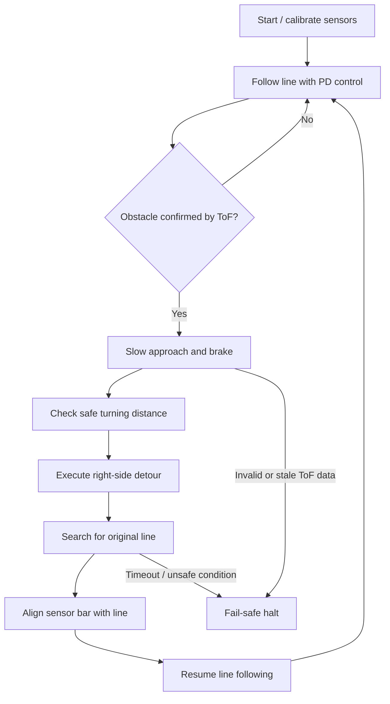

<div align="center">

# T12 Autonomous Line-Following Robot

### Obstacle avoidance · Automatic line reacquisition · ESP32 embedded control

<p>
  
  
  
</p>
<p>
  
  
  
  <a href="https://github.com/NirmalyaLenka/autonomous-line-follower-obstacle-avoidance/stargazers"></a>
</p>

**A documented embedded-robotics project for the BPUT Tech Carnival 2026 T12 challenge.**

The robot follows a marked track, detects an obstacle with a time-of-flight sensor, executes a calibrated right-side detour, searches for the track, aligns itself, and resumes line following.

</div>

---

## Overview

This project combines sensor-based line tracking with a finite-state machine for obstacle handling. It is built around an **ESP32 Dev Module**, a **TB6612FNG dual motor driver**, digital IR line sensors, and a **VL53L0X-compatible time-of-flight (ToF) distance sensor**.

The main engineering goal is not just to avoid an obstacle—it is to **find the original line again and continue autonomously**.

> **Read before powering the robot:** the repository documents known differences between the hardware brief and the uploaded sketch, including the defective IR1 input. Read [Code vs. brief mismatches](docs/CODE_VS_BRIEF_MISMATCHES.md) and verify the actual wiring and sensor behaviour before a full-speed run.

## Behaviour



## Key features

- **Line tracking:** weighted sensor position with a PD-style control loop and speed reduction on larger tracking errors.
- **Obstacle sensing:** VL53L0X-compatible ToF readings with validity checks and consecutive-reading confirmation.
- **Right-side detour:** explicit state-machine phases for turning, shifting, passing the obstacle, and returning toward the line.
- **Line reacquisition:** separates detecting the line from centring the sensor bar; resumes only after alignment checks.
- **Fail-safe paths:** timeouts, stale-sensor checks in key states, emergency-distance handling, and a stop command.
- **Build documentation:** wiring, GPIO map, bill of materials, geometry, calibration, tuning, troubleshooting, and known mismatches.

## Hardware

| Component | Role | Notes |
|---|---|---|
| ESP32 Dev Module | Main controller | Arduino IDE; ESP32 core 2.x or 3.x |
| TB6612FNG | Dual H-bridge | Drives left and right motors independently |
| 2 × BO geared DC motors | Differential drive | Verify motor voltage and stall current for the actual motors |
| Digital IR line sensors | Track detection | Six usable positions are documented; IR1/GPIO14 is marked defective |
| VL53L0X-compatible ToF sensor | Obstacle distance | I²C interface using the Adafruit VL53L0X library |
| 7.4 V nominal battery | Motor power source | Capacity and discharge rating must be verified |
| Buck converter | Regulated logic supply | Measure the output before connecting the ESP32 |
| Custom chassis | Mechanical platform | Reference geometry is approximately 250 mm long and 190 mm wheel span |

Full details: [Bill of materials](hardware/BOM.md) · [Pinout](hardware/PINOUT.md) · [Wiring](docs/WIRING.md) · [Power architecture](hardware/POWER_ARCHITECTURE.md).

## GPIO reference

| Function | ESP32 GPIO |
|---|---:|
| Left motor PWM / direction | 25 / 26 / 27 |
| Right motor PWM / direction | 32 / 33 / 4 |
| TB6612FNG standby | 5 |
| IR line sensors | 14, 13, 16, 17, 18, 19, 23 |
| ToF I²C SDA / SCL | 21 / 22 |
| On-board BOOT button / LED | 0 / 2 |

**Electrical caution:** ESP32 GPIO pins are not 5 V tolerant. Confirm the sensor output voltage before connecting it, use a common ground, verify battery polarity, and measure the buck converter output before attaching electronics. See the full [pinout and wiring notes](hardware/PINOUT.md).

## Software setup

### Required software

- [Arduino IDE](https://www.arduino.cc/en/software)
- ESP32 board support installed through Boards Manager
- **Adafruit VL53L0X** library from Library Manager (Adafruit BusIO is installed as a dependency)

### Upload the firmware

1. Read [Hardware](docs/HARDWARE.md), [Wiring](docs/WIRING.md), and [Code vs. brief mismatches](docs/CODE_VS_BRIEF_MISMATCHES.md) before connecting the battery.
2. Open `src/main.ino` in Arduino IDE. If prompted to place the sketch in a matching `main` folder, accept the prompt or copy it to `main/main.ino`.
3. Select **ESP32 Dev Module**, install the listed library, select the correct serial port, and upload.
4. Open Serial Monitor at **115200 baud**. Check sensor initialisation and geometry messages.
5. Keep the wheels lifted for the first motor-direction test. Start slowly and calibrate before attempting the complete obstacle course.

### Useful serial commands

| Command | Purpose |
|---|---|
| `h` | Show the firmware help |
| `s` | Start / stop |
| `t` | Motor test |
| `i` | Inspect IR sensor readings |
| `v` | Inspect ToF readings |
| `g` | Print obstacle geometry |
| `c` | Run sensor calibration |
| `o` | Run the detour test from the specified starting position |

Check the on-device help output in case commands differ from your current sketch revision. See [Calibration](docs/CALIBRATION.md), [Tuning](docs/TUNING.md), and [Troubleshooting](docs/TROUBLESHOOTING.md).

## Skills required

You do **not** need AI, machine learning, ROS, computer vision, cloud services, or wireless networking to build this version. The project is a classical embedded-control robot.

### Essential to build and commission it

- **Basic electronics and safe wiring:** polarity, common ground, voltage measurement, and use of a multimeter.
- **Arduino IDE basics:** install a board package and library, select a board/port, upload firmware, and use Serial Monitor.
- **Sensor setup:** adjust IR module thresholds and confirm digital outputs; check the ToF sensor over I²C.
- **Motor-driver basics:** understand direction inputs, PWM speed control, standby/enable, and motor power versus logic power.
- **Mechanical calibration:** mount sensors rigidly, measure chassis dimensions, and tune turn/pass timing on the actual floor.

### Essential if you want to modify or debug the firmware

- **C/C++ fundamentals:** variables, functions, constants, arrays, conditional logic, and reading compiler errors.
- **ESP32 GPIO and I²C:** digital input polarity, pin mapping, and reading a distance-sensor library.
- **Control logic:** basic PD feedback, finite-state machines, non-blocking timing, and serial debugging.
- **Experimental tuning:** measure travel speed and turning time; do not assume the reference values transfer perfectly to a different chassis.

### Optional—not used by the current firmware

- Gyroscope / IMU integration
- ROS or ROS 2
- Computer vision or AI
- Wireless telemetry, cloud dashboards, or remote control
- Custom PCB design or advanced CAD

## Calibration and testing checklist

- [ ] Confirm every IR sensor switches reliably between the track and floor.
- [ ] Verify that the defective IR1 input is not affecting line-position calculations.
- [ ] Verify ToF readings at known distances and confirm that its mount faces forward.
- [ ] Measure motor direction, speed, and braking behaviour with the wheels lifted first.
- [ ] Measure chassis dimensions and calibrate travel distance and turn durations.
- [ ] Test line following at low speed before adding an obstacle.
- [ ] Test obstacle detection, emergency stop, line search, alignment, and resume as separate steps.
- [ ] Run a complete course only after the individual tests pass.

## Known limitations

These are important engineering constraints, not cosmetic details:

- **Right-side bypass only:** the firmware assumes the right side is clear; it does not scan for a safe alternate direction.
- **Open-loop detour motion:** shift, pass, and turn distances are mainly time-based. Battery voltage, floor friction, wheel diameter, and motor variation affect the actual path.
- **ToF initialisation failure:** if the ToF sensor is not detected at startup, obstacle avoidance is disabled while line following can continue. Do not treat this as full obstacle protection.
- **IR1 mismatch:** IR1/GPIO14 is documented as defective, but the sketch still scans that input. Verify or correct this before relying on the sensor weighting.
- **No battery or stall monitoring:** the current firmware does not implement battery-voltage monitoring, motor-stall detection, or a check that the detour side is clear.
- **Calibration is chassis-specific:** geometry and timing constants must be measured again if the chassis, wheels, motors, or battery change.

Detailed analysis: [Obstacle avoidance](docs/OBSTACLE_AVOIDANCE.md) · [Robot-size adaptation](docs/ROBOT_SIZE_ADAPTATION.md) · [Math and geometry](docs/MATHEMATICS.md).

## Repository structure

```text
.
├── src/
│   └── main.ino
├── hardware/
│   ├── BOM.md
│   ├── PINOUT.md
│   └── POWER_ARCHITECTURE.md
├── docs/
│   ├── ARCHITECTURE.md
│   ├── CALIBRATION.md
│   ├── CODE_VS_BRIEF_MISMATCHES.md
│   ├── CONTROL_ALGORITHM.md
│   ├── HARDWARE.md
│   ├── MATHEMATICS.md
│   ├── OBSTACLE_AVOIDANCE.md
│   ├── ROBOT_SIZE_ADAPTATION.md
│   ├── TROUBLESHOOTING.md
│   ├── TUNING.md
│   └── WIRING.md
├── diagrams/
├── examples/
├── CONTRIBUTING.md
├── CODE_OF_CONDUCT.md
└── LICENSE
```

## Technical documentation

- [System architecture](docs/ARCHITECTURE.md)
- [Control algorithm](docs/CONTROL_ALGORITHM.md)
- [Obstacle-avoidance state machine](diagrams/state_machine.md)
- [Obstacle geometry diagram](diagrams/obstacle_geometry.md)
- [Calibration guide](docs/CALIBRATION.md)
- [Parameter tuning](docs/TUNING.md)
- [Troubleshooting](docs/TROUBLESHOOTING.md)
- [Contributing guide](CONTRIBUTING.md)

## Project status

This repository contains firmware and build documentation. A recorded hardware demonstration and measured repeatability results should be added when available; no speed, accuracy, or reliability benchmark is claimed here.

## License

Released under the [MIT License](LICENSE).


---

## Maintenance & Audit

- **Audit date:** 10 November 2026
- **Documentation status:** README reviewed and audit record added on this date.
- **Scope and evidence:** This is a documentation-level maintenance pass. It does not establish that source code compiles, dependencies are current, security has been tested, or runtime behavior has been verified.
- **Code and tests:** No new functional code changes or test results are claimed by this README update. Run project-specific build, test, and security checks before relying on the project.
- **Maintenance baseline:** Documentation status recorded through 10 November 2026; revisit setup instructions, dependencies, security, known limitations, and tests when the project changes.
