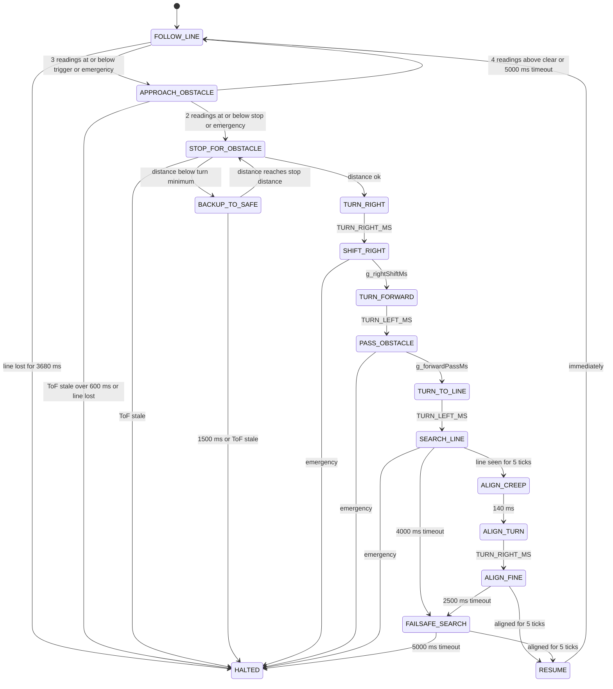

# Obstacle state machine

Matches `avGoto()` / `avStep()` / `runStep()` in `src/main.ino`. `HALTED` is `g_state = ST_IDLE`
(motors braked, reached through `haltRobot()`).

## Transitions

| From | To | Condition (code) |
|---|---|---|
| FOLLOW_LINE | APPROACH_OBSTACLE | `emergencyNow()` or (`g_ignoreObstUntil` passed and `obstacleAhead()`) |
| APPROACH_OBSTACLE | STOP_FOR_OBSTACLE | `emergencyNow()` or `g_stopCnt >= OBSTACLE_STOP_CONFIRM` |
| APPROACH_OBSTACLE | FOLLOW_LINE | `g_clearCnt >= OBSTACLE_CLEAR_CONFIRM`, or `e > APPROACH_TIMEOUT_MS` (then `g_ignoreObstUntil = now + 500`) |
| APPROACH_OBSTACLE | HALTED | stale ToF longer than `TOF_STALE_HALT_MS`; or the follower halts |
| STOP_FOR_OBSTACLE | BACKUP_TO_SAFE | `g_dist < g_turnMinMm` |
| STOP_FOR_OBSTACLE | TURN_RIGHT | otherwise |
| BACKUP_TO_SAFE | STOP_FOR_OBSTACLE | `g_dist >= g_stopEffMm` |
| BACKUP_TO_SAFE | HALTED | `e >= BACKUP_MAX_MS`, or stale |
| TURN_RIGHT | SHIFT_RIGHT | `e >= TURN_RIGHT_MS` |
| SHIFT_RIGHT | TURN_FORWARD | `e >= g_rightShiftMs` |
| TURN_FORWARD | PASS_OBSTACLE | `e >= TURN_LEFT_MS` |
| PASS_OBSTACLE | TURN_TO_LINE | `e >= g_forwardPassMs` |
| TURN_TO_LINE | SEARCH_LINE | `e >= TURN_LEFT_MS` |
| SEARCH_LINE | ALIGN_CREEP | `g_stable >= LINE_CONFIRM_READINGS` |
| SEARCH_LINE | FAILSAFE_SEARCH | `e >= LINE_SEARCH_TIMEOUT_MS` |
| ALIGN_CREEP | ALIGN_TURN | `e >= ALIGN_CREEP_MS` |
| ALIGN_TURN | ALIGN_FINE | `e >= TURN_RIGHT_MS * ALIGN_TURN_PERCENT / 100` |
| ALIGN_FINE | RESUME | `centerAligned()` for `CENTER_CONFIRM_READINGS` ticks |
| ALIGN_FINE | FAILSAFE_SEARCH | `e >= ALIGN_TIMEOUT_MS` |
| FAILSAFE_SEARCH | RESUME | `centerAligned()` for `CENTER_CONFIRM_READINGS` ticks |
| FAILSAFE_SEARCH | HALTED | `e >= FAILSAFE_SEARCH_MS` |
| RESUME | FOLLOW_LINE | immediately (restarts the ramp, caps speed, ignores obstacles for 100 ms) |

Every state except FOLLOW_LINE and APPROACH_OBSTACLE starts with a 150 ms brake pause
(`AV_SETTLE_MS`). The `o` serial command starts at TURN_RIGHT and halts at RESUME.
